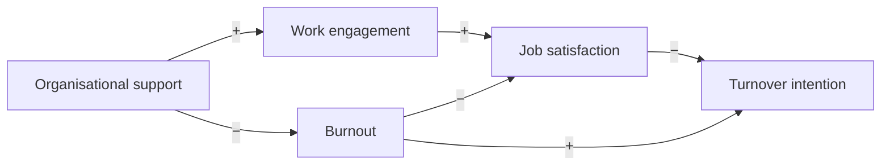
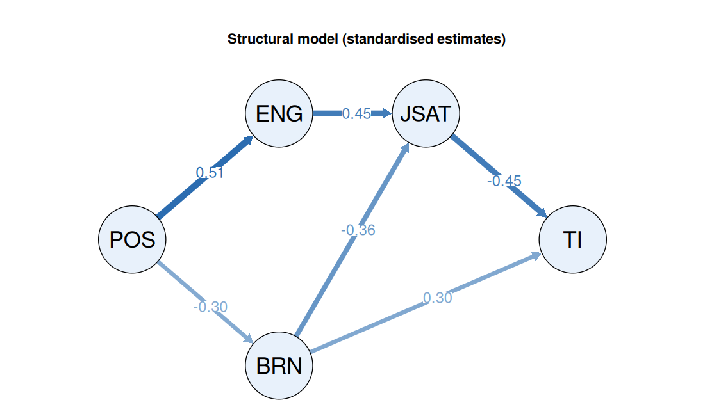
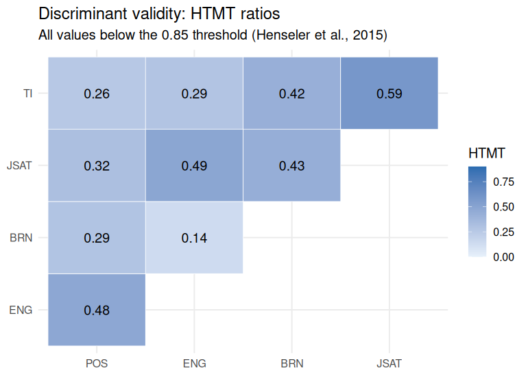
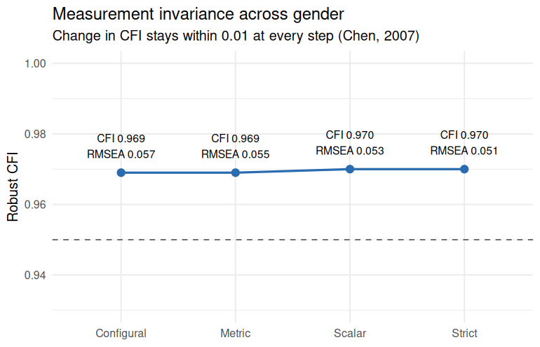

# Covariance-based SEM with full model validation (R, lavaan)


[](https://github.com/alex-sukhoi/cb-sem-full-validation/actions/workflows/reproduce.yml)

A complete, reproducible covariance-based structural equation modelling (CB-SEM) workflow. It covers
the full validation checklist a journal reviewer or thesis committee expects: data screening,
measurement model, reliability, convergent and discriminant validity, common-method bias,
measurement invariance, the structural model with bootstrapped mediation, and alternative models.

> **Data:** synthetic. The survey (n = 480, 18 Likert items) is simulated from a known population
> model in `R/01_simulate_data.R`, so no real respondents are involved and every result can be
> reproduced exactly.

## Research model

How perceived organisational support (POS) relates to turnover intention (TI) through work
engagement (ENG), burnout (BRN) and job satisfaction (JSAT).



## Validation checklist and results

| Step | Test | Criterion | Result |
|---|---|---|---|
| 1. Screening | Skewness / kurtosis | \|skew\| < 2, \|kurt\| < 7 (Curran et al., 1996) | Max 0.15 / 1.10 ✅ |
| | Mardia's multivariate kurtosis | p > .05 | p = .33 ✅; robust **MLR** still used for Likert items, FIML for missing data |
| 2. Measurement model | 5-factor CFA | CFI/TLI ≥ .95, RMSEA ≤ .06, SRMR ≤ .08 | CFI .973, TLI .967, RMSEA .052, SRMR .041 ✅ |
| | Competing models | Hypothesised model fits best | 1-factor CFI .428; 4-factor CFI .792 ✅ |
| 3. Reliability | Cronbach's α, McDonald's ω | ≥ .70 | α .84–.93, ω .84–.93 ✅ |
| 4. Convergent validity | AVE | ≥ .50 (Fornell & Larcker, 1981) | .57–.82 ✅ |
| 5. Discriminant validity | Fornell–Larcker | √AVE > inter-construct r | Met for all pairs ✅ |
| | HTMT | < .85 (Henseler et al., 2015) | Max .59 ✅ |
| 6. Common-method bias | Harman's single factor | < 50% variance | 32.3% ✅ |
| | Full collinearity VIF (Kock, 2015) | < 3.3 | 1.60–2.22 ✅ |
| 7. Measurement invariance (gender) | Configural → metric → scalar → strict | ΔCFI ≤ .01, ΔRMSEA ≤ .015 (Chen, 2007) | Supported at every level ✅ |
| 8. Structural model | Paths, R², bootstrapped indirect effects (1,000 resamples) | 95% CI excludes 0 | All 6 paths and 4 indirect effects significant |
| 9. Alternative models | Fit, AIC, BIC | Lowest AIC/BIC | Hypothesised model preferred |

### Key structural findings

- Organisational support increases engagement (β = .51) and reduces burnout (β = −.30).
- Engagement raises satisfaction (β = .46); burnout lowers it (β = −.37).
- Satisfaction lowers turnover intention (β = −.45); burnout raises it directly (β = .30).
- The total indirect effect of support on turnover intention is negative (β = −.24,
  95% CI excludes 0), so support works **through** engagement, burnout and satisfaction.
- The model explains 39% of the variance in satisfaction and 41% in turnover intention.

## Figures

<p align="center">
  
</p>
<p align="center">
  
  
</p>

## Repository structure

```
R/01_simulate_data.R       synthetic survey from a known population model
R/02_validate_and_fit.R    validation steps 1-9 and all tables/figures
run_all.R                  runs the full pipeline
data/                      generated survey data (CSV)
results/                   one CSV table per validation step
figures/                   path diagram, HTMT heatmap, invariance plot
```

## How to run

```r
install.packages(c("lavaan", "semTools", "psych", "ggplot2", "semPlot"))
source("run_all.R")
```

A GitHub Actions workflow re-runs the pipeline on every push and commits the regenerated outputs.

## References

- Anderson, J. C., & Gerbing, D. W. (1988). Structural equation modeling in practice. *Psychological Bulletin, 103*(3), 411–423.
- Chen, F. F. (2007). Sensitivity of goodness of fit indexes to lack of measurement invariance. *Structural Equation Modeling, 14*(3), 464–504.
- Curran, P. J., West, S. G., & Finch, J. F. (1996). The robustness of test statistics to nonnormality. *Psychological Methods, 1*(1), 16–29.
- Fornell, C., & Larcker, D. F. (1981). Evaluating structural equation models with unobservable variables. *Journal of Marketing Research, 18*(1), 39–50.
- Henseler, J., Ringle, C. M., & Sarstedt, M. (2015). A new criterion for assessing discriminant validity. *Journal of the Academy of Marketing Science, 43*(1), 115–135.
- Hu, L., & Bentler, P. M. (1999). Cutoff criteria for fit indexes. *Structural Equation Modeling, 6*(1), 1–55.
- Kock, N. (2015). Common method bias in PLS-SEM: A full collinearity assessment approach. *International Journal of e-Collaboration, 11*(4), 1–10.
- Podsakoff, P. M., MacKenzie, S. B., Lee, J.-Y., & Podsakoff, N. P. (2003). Common method biases in behavioral research. *Journal of Applied Psychology, 88*(5), 879–903.

---
**Author:** [Oleksii Sukhoi](https://github.com/alex-sukhoi), statistician and data analyst · [LinkedIn](https://www.linkedin.com/in/oleksii-sukhoi-4b60161a7)
